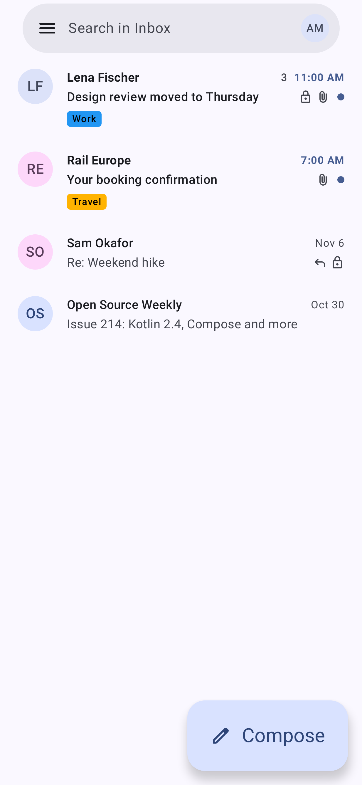
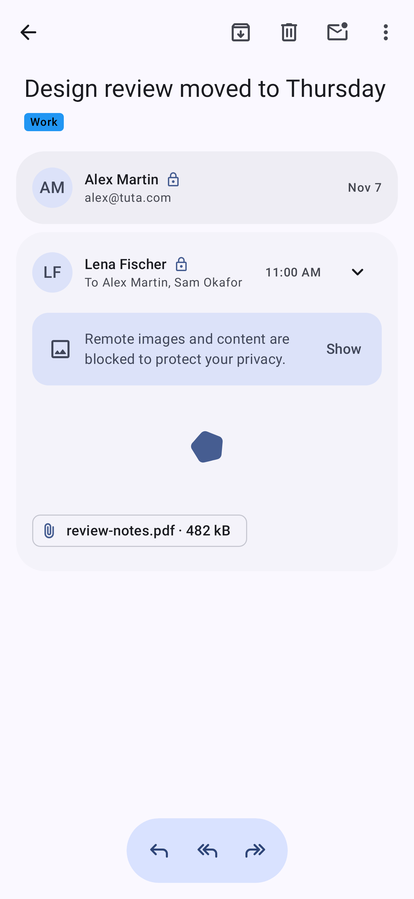
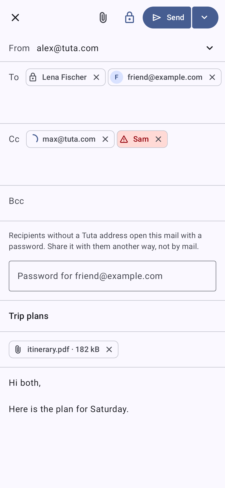
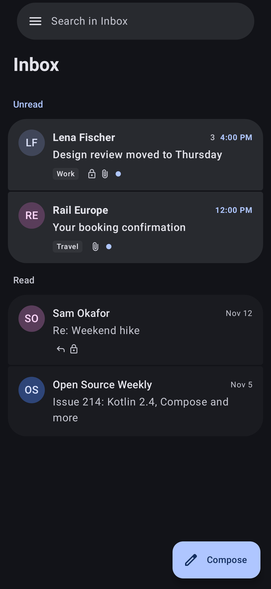
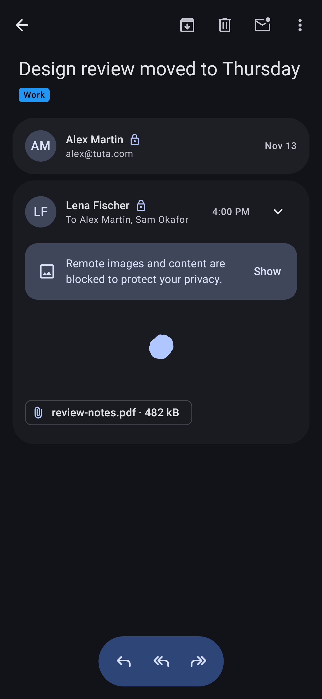
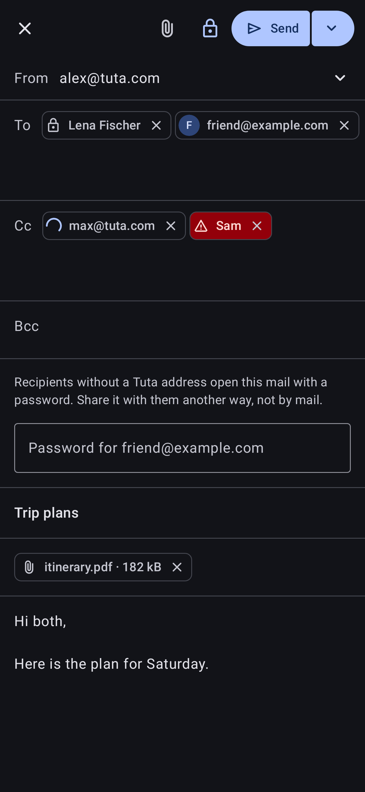
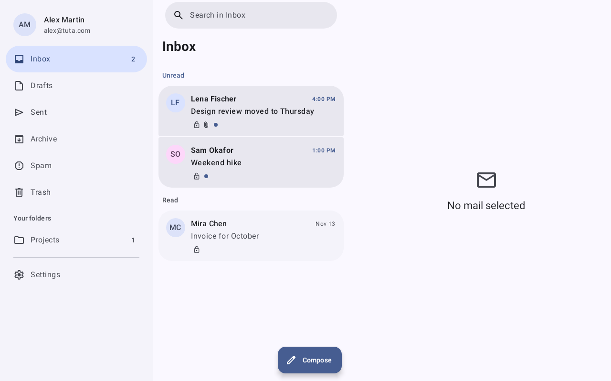

<p align="center">
  
</p>

<h1 align="center">Velin</h1>

<p align="center">
  <strong>Native Android mail client for Tuta.</strong><br>
  <em>Built with Kotlin, Jetpack Compose, and Material 3 Expressive.</em>
</p>

<p align="center">
  <a href="https://developer.android.com"></a>
  <a href="https://kotlinlang.org"></a>
  <a href="https://developer.android.com/jetpack/compose"></a>
  <a href="https://www.rust-lang.org"></a>
  <a href="https://github.com/kacigaya/velin/blob/main/LICENSE"></a>
</p>

Velin is an independent, open-source Android mail client for [Tuta](https://tuta.com).
It uses a native Android interface with gesture navigation, adaptive layouts for tablets and foldables, and Material 3 Expressive theming. Its cryptographic core uses the upstream Rust SDK, compiled as native machine code.

> [!NOTE]
> Velin is an independent open-source project and is not affiliated with, endorsed by, or connected to Tuta GmbH.

## Screenshots

### Phone

| Mailbox | Conversation | Composer |
| :---: | :---: | :---: |
|  |  |  |
|  |  |  |

### Tablet & Foldable

<p align="center">
  
</p>

## Features

- **Native interface:** Uses `MaterialExpressiveTheme` and expressive motion tokens. Supports Android 12+ dynamic color (Material You), with high, medium, and standard contrast palettes from M3 tokens.
- **Adaptive layouts:** Responsive single-pane navigation on phones and dual-pane list-detail layouts on foldables and tablets using `androidx.compose.material3.adaptive` and Navigation 3.
- **Native cryptographic core:** Pinned upstream Rust SDK compiled to native shared libraries (`arm64-v8a` and `x86_64`) with UniFFI Kotlin bindings for entity cryptography and key derivation.
- **Tuta end-to-end encryption:** Unaltered cryptographic model. Argon2id and bcrypt KDF, TOTP/2FA support, and session keys protected by Android Keystore (AES-GCM).
- **Privacy-first HTML email rendering:** Strict HTML sanitization powered by jsoup. Strips executable scripts, dangerous tags, and external CSS. Remote tracking pixels and external images are blocked by default until explicit per-view consent.
- **Offline-ready architecture:** Saved mail is encrypted with a Keystore key. Event replay keeps it current after a reconnect.
- **No tracking:** No analytics, crash telemetry, or third-party network pings.

## Status

The project is under active development across sequential milestones. See [docs/ROADMAP.md](docs/ROADMAP.md) for detailed progress and parity tracking.

| Milestone | Scope | Status |
|---|---|---|
| **M0** | Project scaffold, M3 Expressive theme, stateless screens, Roborazzi screenshot tests | **Done** |
| **M1** | Native Rust SDK AAR build (`arm64-v8a`, `x86_64`), `:core:sdk` adapter, REST transport | **Done** |
| **M2** | Authentication: Argon2id/bcrypt KDF, session lifecycle, Keystore credential storage, TOTP | **Done** (live check pending) |
| **M3** | Read path: mailbox folders, message list paging, decryption pipeline, HTML sanitizer, inline images | **In progress** (pipeline, sanitizer, UI and attachment download done; unread counters not checked live) |
| **M4** | Sync & offline: WebSocket event bus, encrypted local store, durable sync cursors | **Done** |
| **M5** | Mail actions: read state, archive, move, trash, labels, spam reporting | **In progress** (all but spam reporting done) |
| **M6** | Compose & send: drafts, attachment encryption/upload, internal confidential and external mail | **In progress** (drafts, confidential send to Tuta, reply and forward done) |
| **M7** | Background sync: SSE push notifications, quick actions, background lifecycle | Planned |

## Architecture

Velin combines the upstream Rust core with a native Android interface:

```
┌────────────────────────────────────────────────────────┐
│                      :feature:mail                     │
│    (Screens, ViewModels, Compose Adaptive, Gestures)   │
└───────────────────────────┬────────────────────────────┘
                            │ depends on
                            ▼
┌────────────────────────────────────────────────────────┐
│                      :core:domain                      │
│           (Domain models, Repository contracts)        │
└───────────────────────────▲────────────────────────────┘
                            │ implemented by
                            ▼
┌────────────────────────────────────────────────────────┐
│                       :core:data                       │
│    (Offline reconciliation, Mail pipeline, Decryption) │
└──────┬────────────────────┬────────────────────┬───────┘
       │                    │                    │
       ▼                    ▼                    ▼
┌──────────────┐    ┌───────────────┐    ┌──────────────┐
│  :core:html  │    │   :core:sdk   │    │:core:database│
│  (Sanitizer) │    │  (Rust AAR)   │    │  (SQLCipher) │
└──────────────┘    └───────────────┘    └──────────────┘
```

- **Rust SDK (`:core:sdk`):** Upstream Rust client core compiled as an AAR. Handles cryptography, entity hashing, and key derivation.
- **Kotlin UI & Data (`:feature:*`, `:core:data`):** Implements presentation, state management, offline database, and network transport without any WebView dependency.
- **Strict module isolation:** `feature → domain ← data → (sdk, network, database)`. UI modules never touch raw Tuta entities or crypto primitives directly.

## Module Layout

| Module | Responsibility |
|---|---|
| [`:app`](app/) | Application entry point, splash screen, adaptive navigation shell, DI assembly |
| [`:core:designsystem`](core/designsystem/) | Material 3 Expressive theme, dynamic color palettes, typography, shared icons |
| [`:core:domain`](core/domain/) | Pure Kotlin domain models, repository interfaces, and use cases |
| [`:core:data`](core/data/) | Mail repositories, offline caching, decryption pipeline, image consent store |
| [`:core:sdk`](core/sdk/) | Pinned Rust SDK AAR, UniFFI binding extensions, typed Kotlin adapters |
| [`:core:html`](core/html/) | Email HTML sanitizer (jsoup), safe style preservation, CID image rewriting |
| [`:core:network`](core/network/) | HTTP engine, required headers (`cv`/`v`), session interceptors, SSE connection |
| [`:feature:auth`](feature/auth/) | Sign-in screen, two-factor authentication (TOTP), saved account selection |
| [`:feature:mail`](feature/mail/) | Mailbox list, folder drawer, conversation view, plain-text composer |
| `:core:database` *(planned)* | SQLCipher store with a search index (M8) |
| `:core:notifications` *(planned)* | SSE notification listener, background worker, system notification channels |

## Develop

### Prerequisites

- **JDK 21**
- **Android SDK Platform 37** (build-tools 35.0.0 or newer)
- **Rust toolchain & Android NDK** (only required if rebuilding native SDK libraries)

### Build & Run

1. Configure your Android SDK location in `local.properties`:

```properties
sdk.dir=/path/to/android-sdk
```

2. Build the debug APK:

```bash
./gradlew :app:assembleDebug
```

3. Run unit and domain tests:

```bash
./gradlew testDebugUnitTest
```

4. Verify or record screenshot tests using Roborazzi:

```bash
# Verify existing screenshots against test renders
./gradlew testDebugUnitTest -Proborazzi.test=true

# Record new baseline screenshots
./gradlew testDebugUnitTest -Proborazzi.record=true
```

Baseline screenshots are stored under `*/build/outputs/roborazzi/`.

### Rebuilding the Native SDK

The Rust core is compiled from a pinned commit using `tools/backend/build-sdk.sh`. Host `clang` and `lld` cross-compile the SDK against NDK sysroots for `arm64-v8a` and `x86_64`:

```bash
./tools/backend/build-sdk.sh
```

See [docs/backend/NATIVE-BUILD.md](docs/backend/NATIVE-BUILD.md) for toolchain dependencies, UniFFI binding generation, and advisory tracking.

## Documentation

- [Architecture Guide](docs/ARCHITECTURE.md) — Module boundaries, layer dependency rules, and UI state handling.
- [Project Roadmap](docs/ROADMAP.md) — Milestone checklists, parity tracker, and open risks.
- [Native Build Guide](docs/backend/NATIVE-BUILD.md) — Compiling the Rust SDK AAR and binding generation.
- [Backend Feasibility Study](docs/research/backend-feasibility.md) — Upstream protocol analysis, encryption scheme, and entity hierarchy.

## License

Velin is licensed under the [GNU General Public License v3.0](LICENSE).

Icons are [Material Symbols](https://github.com/google/material-design-icons) by Google, licensed under the Apache License 2.0.
